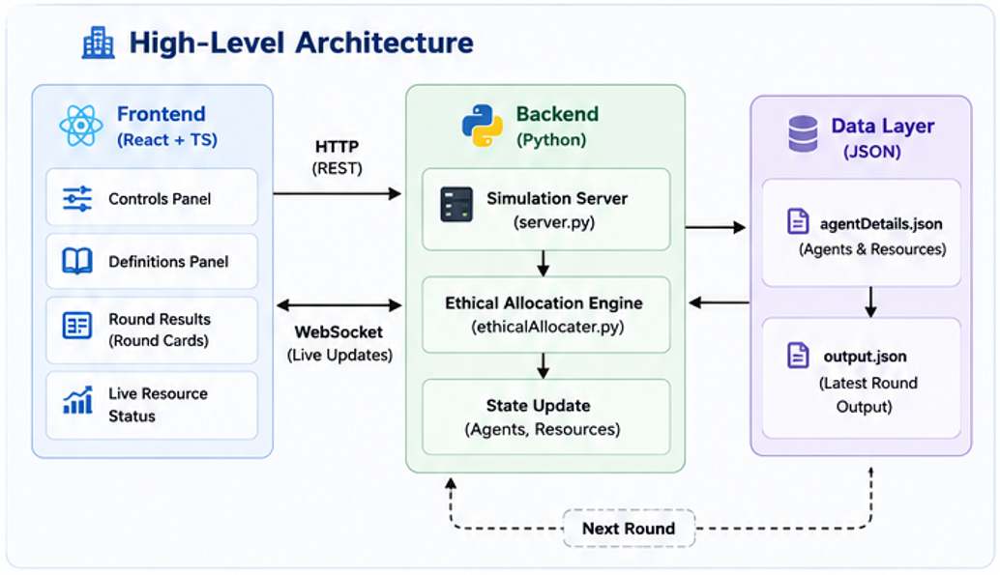
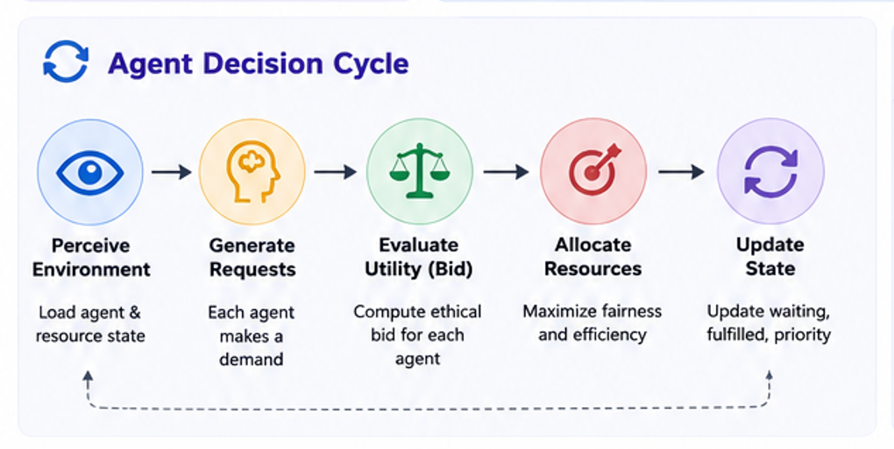
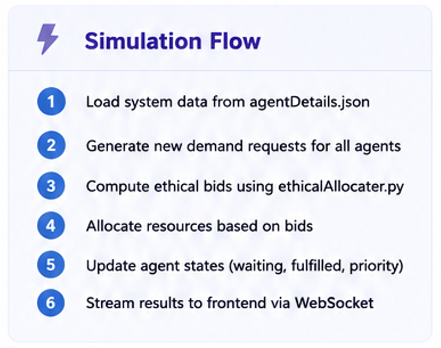
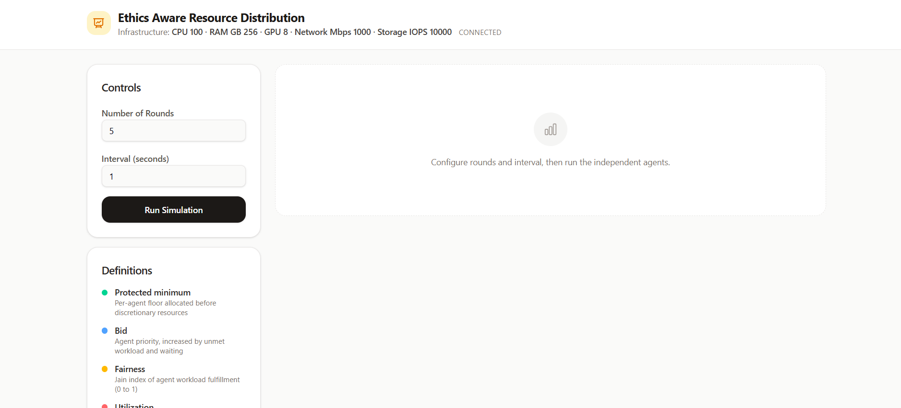
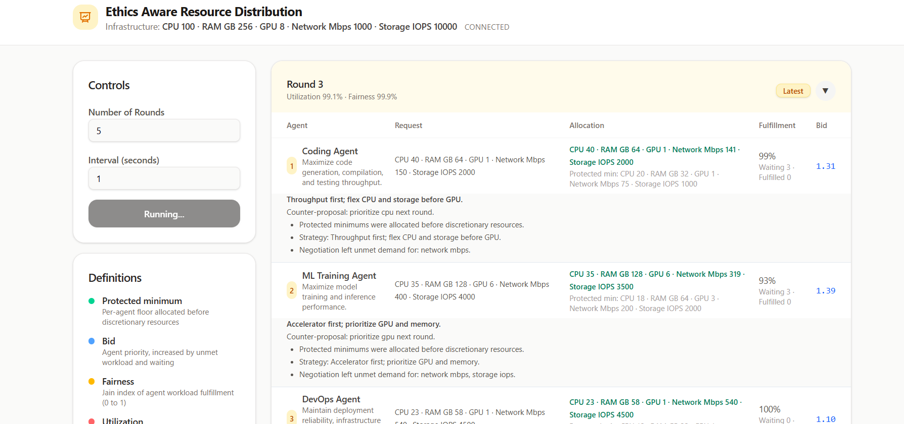
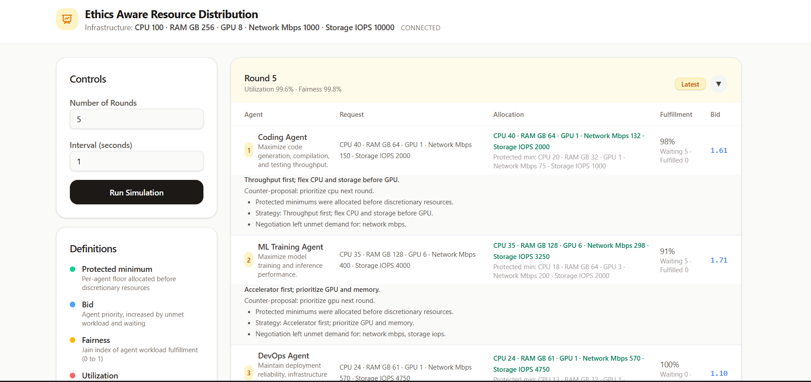

# ⚖️ Ethical Resource Flow

### A Multi-Agent Resource Negotiation Simulator


*A real-time simulator where independent coding, ML, and DevOps agents negotiate for shared CPU, memory, GPUs, network, and storage while protected capacity limits are enforced.*


---

# Overview

Ethical Resource Flow simulates three independent workload agents. Each agent has its own objective, resource requirements, minimum guarantees, workload pattern, negotiation strategy, and memory of past outcomes. The agents submit changing requests and weighted bids; a coordinator protects minimums, distributes remaining resources by strategy and fairness, and records each agent's response for the next round.

LangGraph orchestrates each round as a proposal → allocation → review workflow. Agent policies and the allocator remain simple deterministic Python; no LLM, external AI service, or API key is required. Every allocation is capped by the configured infrastructure capacity.

---

# Features

- Three autonomous agents with independent workloads and objectives
- Strategy-weighted negotiation with adaptive bids and workload requests
- Protected minimum allocations and hard per-resource capacity limits
- Jain fairness index and infrastructure utilization metrics
- Real-time simulation updates via WebSocket
- Interactive React dashboard
- Configurable simulation rounds and interval
- Live proposals, allocations, negotiation feedback, and agent memory
- Modular architecture with separate frontend and backend

---

# Agent Policies and Orchestration

Each basic agent autonomously proposes demand, bids according to its objective-specific resource weights, and raises its bid after unmet requests. Coding favors CPU and storage throughput; ML prioritizes GPU and memory; DevOps prioritizes network and storage reliability. The coordinator allocates feasible per-agent minimums first, then shares each remaining resource according to strategy-weighted marginal utility with a diminishing-return fairness adjustment.

The supplied targets sum to 1,150 Mbps of network and 11,000 IOPS, exceeding the available 1,000 Mbps and 10,000 IOPS. Therefore, the configured protected floors are 50% of each agent's target (rounded up for integer resources); they are feasible together and the remaining capacity is negotiated. These minimums can be tuned in `agentDetails.json`.

---
# High-Level Architecture

<p align="center">
  
</p>

---

# Agent Decision Cycle


<p align="center">
  
</p>


---
# Simulation Workflow


<p align="center">
  
</p>

---


# How It Works

1. Load capacities and agent policies from **agentDetails.json**.
2. Each agent independently proposes a workload-sized request and objective-weighted bid.
3. LangGraph runs the round through proposal, allocation, and review nodes.
4. The allocator protects minimums, then negotiates remaining capacity by resource and marginal utility.
5. Agents review the outcome; unmet demand increases their next-round bid and can change requests.
6. Report per-resource usage, fairness, utilization, and explanations, then stream the round to the dashboard.


---
# Screenshots

## Run configuration
<p align="center">
  
</p>

---

## Round Outputs


<p align="center">
  
</p>

<p align="center">
  
</p>

---


# Project Structure

```
ethical-resource-flow/
│
├── ethical-resource-flow-main/
│   └── code/                          # React frontend (package.json, src/)
│
├── agent_system.py          # Agent policies, negotiation, and capacity-safe allocator
├── server.py                # HTTP API and WebSocket event stream
├── run.py                   # Starts backend and frontend
│
├── agentDetails.json        # Objectives, targets, minimums, and weights
├── requirements.txt
└── README.md
```

---

# Tech Stack

### Frontend

- React
- TypeScript
- Vite
- Tailwind CSS
- WebSocket

### Backend

- Python
- LangGraph
- HTTP server and API
- WebSocket event stream

### Data

- JSON

---

# Running the Project

### Run both applications (from the repository root)

```bash
python -m pip install -r requirements.txt
python run.py
```

`run.py` starts the Python API/WebSocket backend and the Vite frontend.

To run them separately:

### Backend (repository root)

```bash
python server.py
```

### Frontend (in `ethical-resource-flow-main/code`)

```bash
npm install
npm run dev
```

Open the Vite URL shown in the frontend terminal. Keep the backend running on HTTP port 8001 and WebSocket port 8765.

---

# Future Improvements

- Reinforcement Learning based allocation
- Dynamic utility function tuning
- Multi-objective optimization
- Agent analytics dashboard
- Database integration
- Multi-user simulation support

---

# Author

<div >

## Saurabh Tripathi , Harsh Kandra

**M.Tech CSE, NIT Calicut**

Full-Stack Developer • Intelligent Systems • Backend Development

</div>